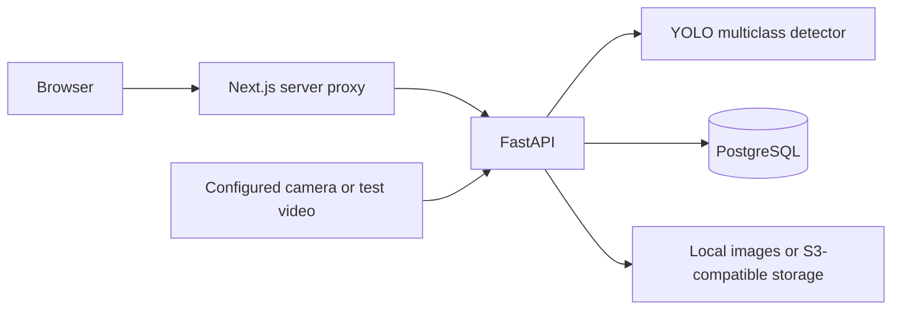

# Detectra: Phase III Implementation and Testing

CIS 553: Software Engineering, Fall 2026  
Elyann Soto and Evan Wilson  
Status reviewed November 5, 2026; branch `codex/phase-3-implementation`

## 1. Project Overview

Detectra is a local web prototype for finding animals and people in uploaded images or camera frames. Users can inspect the confidence scores, reveal individual bounding boxes, and save Correct/Incorrect feedback. The project began with lizard detection as its main use case. The retained `yolov8s-oiv7` model now supports eleven categories through one detector. Phase III focuses on reproducing the application, checking its workflows, and preparing a tested delivery process. It does not train a new model.

## 2. Implemented Features

The dashboard links to image upload, Camera Scan, results, settings, and usage instructions. Uploads use real YOLO inference. Results show boxes and confidence scores, allow individual boxes to be hidden, and retain human reviews in PostgreSQL. Images without detections can also receive a review. Selecting no species disables detection without changing the model weights.

The camera backend supports one configured stream, live inference, on-demand capture, optional interval-based saving, and reconnection. Scan Now stores the frame and its metadata through the same analysis path as uploads. RTSP credentials stay in backend configuration and are removed from browser-facing status. Physical-camera operation still needs validation; automated camera tests use a generated video or controlled frame fixtures.

The local database scripts create the six application tables and insert fictional examples. Initialization rejects unrelated existing schemas and remote targets; repeating setup or seed does not reset records. Sample detections are visibly synthetic and are never presented as measured model performance.

## 3. Changes from Phase II

The comparison uses the [Phase II report preserved at commit cf37ec6](https://github.com/elyannmarih/Computer-Vision-Based-Animal-Detection-and-Monitoring-System/blob/cf37ec6/docs/CIS553_Group07_ProjectPhaseII_Report.pdf), especially the requirements on page 4 and planning tables on pages 11-16.

| Phase II scope | Current implementation |
| --- | --- |
| Train or fine-tune a lizard detector | Retain the original multiclass Open Images model after the earlier experimental comparison; no additional training in Phase III |
| Cloudinary image storage | Local files by default, with optional S3-compatible storage; PostgreSQL retains metadata and reviews |
| Controlled prototype without individual accounts | Still the supported scope; authentication remains required before public application hosting |
| Human feedback for later evaluation | Feedback persists and can be corrected; it does not trigger retraining |
| Camera scans and optional continuous monitoring | One configured stream supports live inference, Scan Now, and optional timed saves; physical validation is pending |
| CI/CD and deployment scheduled later in November | Application checks and Docker delivery passed in GitHub Actions; merge, final artifact publication, and repository visibility remain pending |

Email verification links, multiple simultaneous live streams, analytics, automatic retraining, and RT-DETR comparison are not claimed as completed. The original interface layout was retained. The final audit replaced a demo photograph of unconfirmed origin with synthetic shapes without changing the UI structure.

## 4. Implementation Architecture

The server-side Next.js proxy validates API responses and keeps backend configuration out of browser code. FastAPI coordinates inference, storage, and transactional feedback. PostgreSQL contains `cameras`, `models`, `trusted_persons`, `images`, `detections`, and `human_verifications`. The reviewer list identifies feedback authors; it does not authenticate them.

Compose runs PostgreSQL, FastAPI, and Next.js with separate persistent volumes for database records, uploads, model preferences, and the frontend cache. Application containers run as non-root users with read-only code. Only the frontend is published, on the host loopback address. Model weights remain unchanged; writable selection preferences live separately from them.

## 5. Software Testing

The [test record](phase-3-test-results.json) contains commands, UTC timestamps, individual test names, counts, and log hashes. All results below were executed on November 5, 2026. They are recorded runs from the indicated milestone, not an assertion that every suite was rerun after each documentation edit.

| Executed check | Result | Scope |
| --- | --- | --- |
| Python unit suite | 47 passed, 0 failed, 0 skipped | Transactions, feedback aggregation, configuration, camera sanitization/recovery, model selection, and evaluation logic |
| PostgreSQL and YOLO integration suite | 22 passed, 0 failed, 0 skipped | Real database writes, schema and seed, inference, invalid files, concurrent feedback, and controlled camera capture |
| Browser regression suite | 109 passed, 0 failed, 0 skipped | API contracts plus desktop Chromium, mobile Chromium, and WebKit; API responses are simulated |
| Real system browser suite | 5 passed, 0 failed, 0 skipped | Real Next.js, FastAPI, PostgreSQL, YOLO, and generated-video workflows |
| Docker source and packaged-delivery checks | 8 passed in each run | Health, upload, inference, feedback, failure recovery, and persistence after container replacement |
| Delivery verification | 7 file checksums verified; three image IDs restored | Export/load round trip and rejection of altered contents or untested images |

The application suites ran locally on Windows and in the isolated Linux CI rehearsal recorded in milestone 3. Docker validation used Linux amd64 containers through Docker Desktop. The final audit reran the 109 browser checks after replacing the demo and upload fixtures, plus 47 unit tests, mypy, and eight Docker checks against the rebuilt images. All passed. Checks for shared/external test volumes reject the configuration before creating or deleting resources.

Integration tests create random local test databases, temporary uploads, and isolated preferences. They disable private environment loading, S3, and physical camera access. The NASA astronaut fixture has recorded public-domain provenance in `backend/tests/fixtures/provenance.json`. Frontend demo/test images are original geometric drawings, and database sample images are generated by the seed script. These fixtures validate application behavior, not accuracy on wild animals.

## 6. Static Analysis

Mypy passed for 14 Python source files, including checks inside unannotated functions. Its scope covers the API and database helpers; it excludes dependency inspection for Ultralytics and Boto3. It is not a strict typing guarantee for every module. ESLint, TypeScript checking, and the Next.js production build passed in the application and CI milestones. Actionlint 1.7.12 validated the workflow, and the Docker builds exercised the standalone frontend output.

The final security audit used pip-audit 2.10.1 against installed package inventories. The local pip installer was updated from 24.3.1 to 26.3, after which the 70-package local inventory had no reported advisories. The container audit identified an older `setuptools`; `backend/requirements.txt` now requires at least 84.1.0, and the rebuild installed 84.2.1. The final 65-package container inventory reported no advisories for the 63 recognized versions. PyPI did not recognize the two CPU-specific PyTorch versions; a separate advisory lookup using their base versions also returned no findings. That lookup does not independently audit the CPU wheel contents.

`npm audit` reports eight moderate findings in development tooling, all through the [minimatch glob-pattern advisory](https://github.com/advisories/GHSA-g3hv-75wg-m249). `npm audit --omit=dev` reports zero findings. The upstream TypeScript ESLint dependency still requests minimatch 10; the offered automatic fix would downgrade the Next.js ESLint configuration across a major version. That change was not applied. A compatible upstream update or a separately tested override remains follow-up work. Package audits are date-specific and do not cover operating-system packages or establish that the application is secure.

## 7. CI/CD Implementation

`.github/workflows/ci.yml` runs for pull requests to `main`, pushes to `main`, and manual dispatch. The application job installs Python 3.13, Node.js 22, PostgreSQL 16, CPU PyTorch, and browser dependencies, then runs the test and static-analysis commands documented in the README. No shared database, camera, or repository secret is required.

The delivery job depends on the application job. It builds the application images, tests them, exports their exact IDs, verifies and reloads the archive, then tests the packaged Compose configuration with builds and pulls disabled. Failed commands fail the job. Actions are pinned to commit SHAs and the workflow token has read-only repository permissions. Diagnostic logs are retained for seven days.

[GitHub Actions run 42122426016](https://github.com/elyannmarih/Computer-Vision-Based-Animal-Detection-and-Monitoring-System/actions/runs/42122426016), for PR head `8d24056`, passed on November 5, 2026. It passed 47 unit tests, 22 integration tests, 109 browser regression tests, 5 real-backend/YOLO browser workflows, static analysis, the production build, and the Docker delivery checks. The first hosted run timed out during slow Ubuntu package downloads. Commit `8d24056` switched away from the Azure package mirror and separated frontend and browser installation into bounded steps. The successful PR run uploaded diagnostic logs; the downloadable delivery artifact is reserved for a successful run on `main`.

## 8. Deployment and Release Artifacts

The supported demonstration is a local Docker Compose installation. The [README](../README.md#docker) provides setup, environment, seed, start, stop, and persistence instructions. Another machine needs Docker with Linux amd64 support and its own database password. No shared Neon access or camera is needed. A real camera additionally needs a private network route and an explicit configuration choice; automatic saves should remain disabled until captures are approved.

The delivery archive contains backend, frontend, and PostgreSQL images, a Compose file without build instructions, schema SQL, a safe environment example, startup instructions, a manifest, smoke-test evidence, and checksums. It excludes live volumes and private configuration. A successful `main` push or manual run is configured to retain a downloadable artifact for seven days. No registry publication, GitHub Release, or public deployment is configured.

A local development preview was exported and loaded in milestone 5. It predates the final fixture and dependency audit changes, so it is superseded and must not be used as the final submission artifact. Generate the final bundle from the approved committed revision. Keep an existing installation's configuration and project name, back up its volumes, and review future schema changes before upgrading; the schema script is an initializer, not a migration framework.

## 9. Known Limitations

The retained historical evaluation contains 214 partly annotated validation images. Lizard recall was 36.1% (22 detected, 39 missed); conditional precision does not measure overall multiclass precision. The smallest lizards were missed. These earlier research results are not Phase III accuracy tests, and there is no independent final test result. CPU inference cost, field conditions, and physical RTSP reliability still need practical evaluation.

The prototype has no authentication, per-user authorization, or private signed-image delivery. Local images and camera endpoints must remain within a controlled environment. S3 mode expects public image URLs and was not tested against a live bucket in this phase. Do not expose the application or private captures publicly without implementing and validating access controls.

For repository publication, Gitleaks 8.30.1 scanned all local Git refs with full history and reported no secrets. Additional checks covered credential URLs, private-address examples, and exact matches for configured local secrets without printing their values. Matches in the text-pattern check were examples or test fixtures. No credential was identified as needing revocation from this scan.

We are preserving the repository's existing history. The current demo/test images are synthetic. The earlier house photograph remains in previous commits and matches the [entrance image in our Figma design](https://www.figma.com/design/CNNQIPpuNQoz283NL0pyGe/Detectra?node-id=10-679): its Figma image hash matches the historical file's SHA-1, and both have 1600 by 1067 dimensions. The historical Phase II PDF includes two student contact emails. Those emails and normal Git author information are not credentials and are not scheduled for removal. A cleanup trial was verified in a separate local copy, but it has not been applied to this branch or GitHub. Rewriting history is not an application or CI requirement. The repository remains private, and changing its visibility is a separate decision. The audit covers reachable objects, not deleted remote refs, forks, or third-party copies.

## 10. Team Contributions

The Phase II Gantt records planned responsibilities, not proof that work was completed by one person. The table below combines that plan with commit subjects and changed files. It does not assign every line of a commit exclusively to its author.

| Area | Recorded contribution and planning reference |
| --- | --- |
| Frontend and user workflow | Elyann's `1c4055e` adds the Next.js interface and initial tests; `53ff1e8` connects it to FastAPI and feedback. Evan's `e30f312` also changes upload, results, and live-camera integration. The Gantt assigns interface/results/review work to Elyann and image input to Evan. |
| Backend, database, and inference | Evan's commits under `SleepingBear23` include the initial FastAPI implementation and seed (`2700bb0`), YOLO/RTSP backend (`17d6c2c`), and earlier model selection work (`5d1f74d`). These support the backend and database responsibilities in the Gantt. |
| Integration and refinement | Both authors appear in the integrated history. Elyann's later commits include detection/review fixes (`8b50351`), camera-state correction (`1ab98c1`), species selection (`95dd47d`), and consolidation of the retained model (`e1db3ab`). The Gantt lists image integration as shared work. |
| Phase III validation and delivery | The new database, testing, CI, Docker, and delivery commits are recorded under Elyann's account: `3365a97`, `c4080c5`, `a416ffa`, `25368a5`, and `3bebf2b`. Evan's review is pending. The original Gantt assigned testing/mypy mainly to Evan and CI/Docker/deployment to both; this difference needs team confirmation before the final contribution statement is submitted. |

On November 5, direct GitHub checks confirmed a private repository and two open pull requests: [PR #1](https://github.com/elyannmarih/Computer-Vision-Based-Animal-Detection-and-Monitoring-System/pull/1), authored by Evan under `SleepingBear23`, and [PR #2](https://github.com/elyannmarih/Computer-Vision-Based-Animal-Detection-and-Monitoring-System/pull/2) for Phase III. The earlier search that reported no PRs was incomplete. Its original audit snapshot remains in the test record, with a later correction. Existing authorship and commits are preserved.

PR #2 targets `main` from the pushed `codex/phase-3-implementation` branch. Hosted checks have passed, and Evan is the requested reviewer; no review has been submitted as of this update. The review should cover database compatibility, inference and camera behavior, test isolation, delivery, and the contribution notes. Documentation follow-ups belong in this same PR. Merge remains pending review and approval; the planned Gantt is not used to rewrite recorded authorship.

## 11. Conclusion

Detectra has a working local application, reproducible database examples, recorded automated tests, and a container delivery process validated locally and in GitHub Actions. The retained model and personal preferences are unchanged. The branch is pushed and PR #2 is open. Evan's review, merge approval, final delivery artifact publication, physical-camera validation, and the repository visibility decision remain pending. We are keeping the existing development history.
